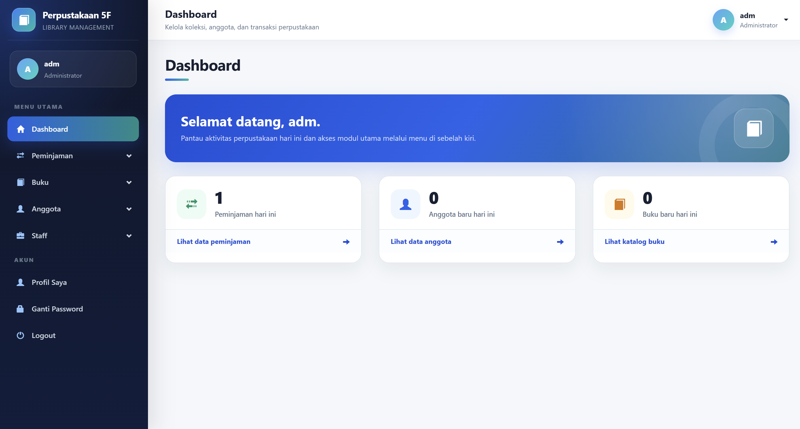

# PHP Perpustakaan 5F

Aplikasi perpustakaan berbasis PHP native dan MySQL. Versi ini tetap menggunakan struktur PHP native dan ditargetkan untuk PHP 8.3.



## Fitur

- Login dan registrasi anggota.
- Tiga role: admin, staff, dan anggota.
- Pengelolaan buku, staff, anggota, peminjaman, dan pengembalian.
- Perhitungan denda buku rusak atau hilang.
- Riwayat peminjaman dan kartu anggota.
- Laporan buku, anggota, staff, dan peminjaman dalam PDF.

## Persyaratan

- PHP 8.3 atau versi lebih baru.
- Ekstensi wajib: `mysqli`, `mysqlnd`, `fileinfo`, dan `session`.
- Ekstensi yang disarankan: `mbstring`, `gd`, dan `curl`.
- MySQL 5.7+ atau MariaDB 10.3+.
- Apache, Nginx, Laragon, XAMPP, atau PHP built-in server untuk pengujian.

## Instalasi Baru

1. Ekstrak project ke folder web server.
2. Salin `.env.example` menjadi `.env`.
3. Sesuaikan koneksi database pada `.env`:

```env
APP_DEBUG=false
APP_TIMEZONE=Asia/Jakarta
DB_HOST=localhost
DB_PORT=3306
DB_NAME=yudhatpm_perpustakaan
DB_USER=root
DB_PASS=
```

4. Import `database/perpustakaan.sql`.
5. Pastikan folder `image/buku` dapat ditulis oleh web server.
6. Jalankan pemeriksaan lingkungan: `php tools/php83_check.php`.
7. Buka project dari browser.

Untuk pengujian menggunakan PHP built-in server dari folder project:

```bash
php -S localhost:8000
```

Kemudian buka `http://localhost:8000`.

## Upgrade Database Lama

Jika database lama sudah berisi data:

1. Backup database terlebih dahulu.
2. Jalankan `database/upgrade_2026.sql` satu kali.
3. Jangan menjalankan file upgrade berulang kali karena file tersebut menambahkan index unik.
4. Jika penambahan index gagal, periksa data username, nomor anggota, nomor peminjaman, atau pasangan buku-peminjaman yang duplikat.

## Akun Pengujian

Admin:

```text
Username: adm
Password: adm1234
```

Anggota:

```text
Username: ytp
Password: ytp1234
```

Password akun contoh masih memakai hash lama di dump database. Setelah login berhasil, aplikasi otomatis mengubahnya ke `password_hash()` modern.

## Catatan Keamanan

- Jangan memakai kredensial database produksi di project yang dibagikan.
- Gunakan `APP_DEBUG=false` pada server publik.
- Hapus atau lindungi file SQL dari akses publik. Project menyertakan `.htaccess` untuk Apache, tetapi konfigurasi Nginx perlu diatur terpisah.
- Ganti seluruh password akun contoh sebelum digunakan untuk produksi.

## Ringkasan Perbaikan

Detail perubahan tersedia di `UPDATES_2026.md`.

## Catatan PHP 8.3

Detail perubahan kompatibilitas tersedia di `PHP83_UPGRADE.md`.

## Redesign antarmuka 2026

Paket ini sudah memakai tampilan baru yang responsif tanpa mengubah fitur aplikasi. Detail perubahan tersedia pada `REDESIGN_2026.md`.

## CATATAN
Project ini diupgrade oleh AI, belum dilakukan testing end-to-end dan belum cocok untuk production
